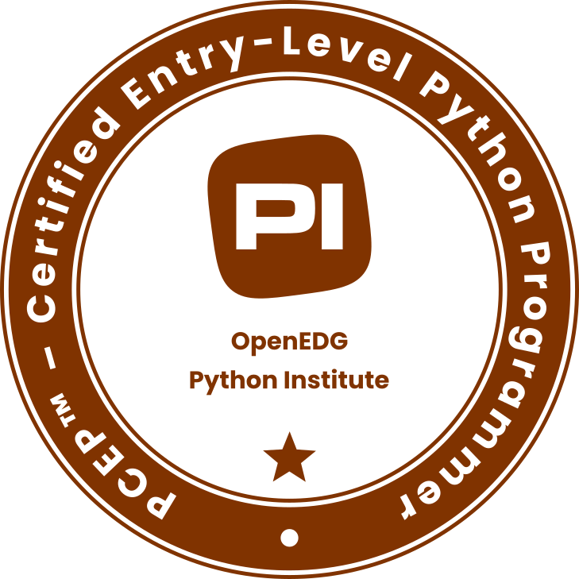

<h2 align="center">Bonjour, je suis Mustapha Belhaouari</h2>

  
  
 

 
---

## 🏆 Python Certification
 <h3 align="left">PCEP-30-03</h3>

  

## 👨‍💻 À propos de moi

-  Développeur Python certifié (PCEP-30-03).
-  Passionné par la programmation et le développement logiciel.
-  En formation dans le domaine de l'intelligence artificielle et du Machine Learning.
-  Intéressé par l'analyse, le traitement et la visualisation des données.
-  Découverte et développement de projets liés à l'Internet des objets (IoT).
-  Réalisation de projets pratiques pour renforcer mes compétences en programmation.
-  Motivé par l'apprentissage continu et les nouvelles technologies.
-  Mon objectif : développer des solutions innovantes en Python et en intelligence artificielle.

---

Compétences 🛠️

  

 

---

## 📊 GitHub Statistics

  
  

  

 
